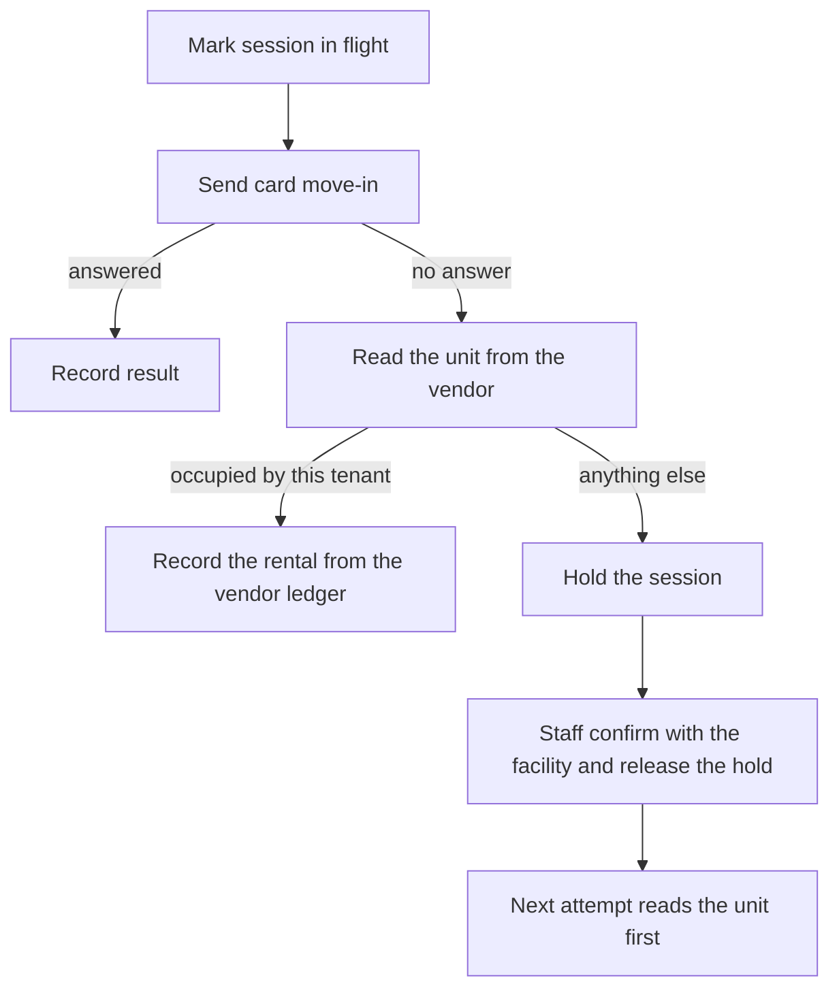

# Migrating a live self-storage checkout between two facility-management systems, one location at a time

*Benjamin Tweedy, November 2026*

## Summary

A self-storage operator with 25 locations rents units online through a checkout I built and run: a customer picks a unit, reserves it, pays the move-in cost by card, and signs the lease, without visiting the office. Every one of those steps is a call into the operator's facility-management system, which owns units, prices, tenants, and ledgers. In 2026 the operator changed vendors for that system and chose to convert one facility at a time over several months.

I designed and built the integration with the second vendor so that both systems serve the same checkout at once and a location moves from one to the other with a setting. It went to production on October 31, 2026, and the first two facilities cut over on November 2. I was the only engineer on it.

## Constraints

These are the facts that shaped the design. Most of them came out of reading the new API and probing its sandbox, not out of the kickoff meeting.

- **Two systems of record for months.** Cutover dates belong to the operator's operations lead and the vendor's conversion team. The website has to follow a facility the morning it converts and cannot ask for a freeze.
- **The payment call cannot be retried.** The new vendor's move-in endpoint takes the card and creates the tenancy in one request, and it accepts no idempotency key. The vendor confirmed that a refused move-in fails whole and leaves no charge. A request that never answers is a different case: the charge may or may not exist.
- **No signal when a lease is signed.** The incumbent system redirects the customer back with the result. The new one has no return URL and no webhook.
- **Different shapes.** One API is SOAP with integer IDs and the other is REST with OAuth 1.0 signed requests and UUIDs. The existing code cast unit IDs to integers in several places, and a UUID that begins with digits casts to an integer that can match another row.
- **A sandbox that is not the client's data.** It held the vendor's generic seed, and its test facility's card processor refused every charge until late in the build. Unit types, amenity names, and rate fields for this operator were unknown until the first real conversion.
- **Card data in scope for PCI DSS.** A new outbound service and a new stored credential had to be designed and documented for that, not added afterward.

## Design

**One seam, two implementations.** The five rental steps (price, reserve, protection plans, pay and move in, lease link) go through one interface with an implementation per vendor. A factory picks the implementation from the location's row and fails closed on a row that is misconfigured. The incumbent's code moved behind the interface unchanged. The page never learns which system it is talking to: each implementation returns its own confirmation fields and plan list in a common shape.

**Unit sync through a translator.** The scheduled and on-demand sync already grouped, classified, and stored units from the incumbent's response. I added a unit source per vendor and a translator that emits the incumbent's field names, so the sync changed in one call. Anything the translator cannot trust fails that location's sync instead of storing a guess, and the other locations keep syncing.

**The switch.** Each location row names its system. A corporate user changes it on a portal screen. The save is refused while the location has online rentals on or rentals in progress, it is a conditional write so two saves cannot interleave, it refreshes the location's units from the new system immediately, and rentals cannot be turned back on until a sync has succeeded. It works in both directions, and every change writes an activity log row.

**One number shown, one number charged.** Before the card goes out, the move-in is quoted again. A quote whose lines do not add up to its total, or a total that differs from the accepted one by half a cent or more, refuses the payment and asks the customer to refresh. I added the same check to the incumbent path while I was there.

**Payment without an idempotency key.** The session row is marked in flight with a conditional update before the request is sent, which is also the lock against a double submit. If the call never answers, the code does not send it again. It reads the unit from the vendor:

A release never charges anything by itself, and it applies only if the row is unchanged since the staff member's page read it.

**Lease signing by poll.** Every ten minutes a scheduled job reads the ledger of each paid rental from the last 21 days, least recently checked first, one run at a time. A signed lease completes the rental through the same code path as the incumbent's redirect, and the completion applies once however many times it is reported. Because ten minutes is a long time to look at a spinner, the signing screen has a button that checks that one rental immediately.

**The handlers do not trust the page.** Turning rentals off at a location used to change only the button. A stale tab or a direct POST could still create a tenant in the wrong system, so every handler now checks the location's state on the server, refuses before any card data is read, and logs the refusal.

## Failure cases

| What happens | What the system does |
|---|---|
| The vendor times out during the card move-in | Reads the unit. Records the rental if the tenant is on it, otherwise holds the session for staff |
| The customer double-clicks Pay, or pays from two tabs | The conditional update lets one request through. The other stops |
| The price changes between the quote and the payment | Payment is refused before the card is sent |
| The customer signs the lease and closes the tab | The poll completes the rental within ten minutes |
| The switch is saved while a rental is in progress | Refused. A save that races another write is refused too |
| The new system answers a sync with units missing required fields | That location's sync fails and its stored units stay as they were. Other locations are unaffected |
| A location has just been switched and no sync has succeeded | Online rentals cannot be turned on there |
| A unit has no price group in the new system | Left out of the storefront and logged, because the vendor cannot quote it |
| A stale page posts to a location whose rentals are off | Refused on the server and logged |

## Trade-offs

**An adapter instead of a rewrite.** Rebuilding the checkout around the new vendor would have produced cleaner code and one implementation. It also would have put the 23 locations that were not moving yet on new code for no benefit to them. I kept the incumbent path untouched and accepted two implementations until the last facility converts.

**The incumbent's data shape as the common language.** The translator emits the old vendor's field names rather than a neutral model. That kept the sync, grouping, and storefront out of the change, and it means the old vendor's vocabulary outlives the old vendor in this codebase. I would not make that choice in a system meant to last past the migration.

**Polling instead of a browser message.** The signing page can post a message to the parent window when the customer finishes. That is immediate and costs no API calls, and it is lost the moment the customer closes the tab or signs on a different device. The server-side poll is slower and costs one ledger read per open rental per cycle, and it cannot be lost.

**Hold instead of retry.** A retry is harmless when the first request never arrived and charges the card twice when it did, and from the outside the two look the same. Reading the unit settles the case where the vendor finished the move-in. Every other case waits for a staff member, which is slower for that customer and never double-charges.

## How it was built

I work with AI tools every day, and this project is the way I use them when money is involved. I wrote the specification for each phase and the rules it had to enforce, AI tools built and tested against it, and each phase was a separate pull request that I reviewed and merged before the next began. The rules in the design section each have a test. Fakes are used only at the vendor boundary, so the integration tests run the real sync and the real handlers against a real database, and the request-signing tests are pinned to signatures verified against the live sandbox.

The day before release I ran an adversarial review of the whole codebase, not only the new branch. I checked each finding against the code and the production schema before acting on it. Two of the reviewer's claims were wrong and I rejected them. The real findings were fixed before release: a held payment that could never be paid after its release, because the unit stays reserved and the release path accepted only vacant units; step writes that were not conditional; the switch as a check followed by a write; and anonymous quote endpoints with no nonce or rate limit.

## Outcome

- Released to production on October 31, 2026 with every location still on the incumbent system. The build ran about four weeks from the first commit.
- On November 2 the vendor converted the two pilot facilities in the morning. After test rentals through the production checkout, online rentals were back on at both that afternoon.
- The day after cutover, a facility manager reported units showing online that had been hidden in the old system. I traced it the same afternoon to the conversion: the old system's hide-from-web setting had not carried over. The site was showing exactly the units the new system marked rentable, and the vendor corrected the units on their side.
- The remaining locations are converting on the operator's schedule, each by the same portal switch.

What I would do differently: insist on one facility's converted data in the sandbox before release. The unit-type and amenity mapping was written against seed data, and the first look at real converted data was production.

*Built with PHP, a REST API, MariaDB, and Vue.js. Client and vendor names are left out.*
