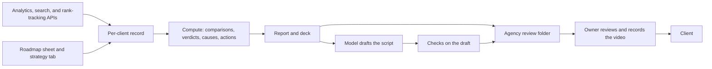

# A monthly client-reporting pipeline for a marketing agency

*Benjamin Tweedy, November 2026*

## Summary

A marketing agency sends each client a monthly report and a short video in which the owner walks through the numbers. I designed and built the system that produces the report, a slide deck, and a draft of the owner's script for every client, from the analytics APIs to the agency's review folder. I was the only engineer. It runs on a monthly schedule for about 20 of the agency's clients across two brands, and a full run takes about 22 minutes.

Every number is computed in code. A language model writes only the script, from the finished report, and each number in its draft is checked against that report. Nothing reaches a client until the owner has reviewed it and recorded the video.

## The problem

Reports were assembled by hand in the second week of each month. The agency's SEO strategist spent 20 to 30 percent of each month pulling rankings and taking screenshots of analytics dashboards. The owner then spent 20 to 30 hours a month reading the screenshots and recording a video per client, for 25 to 35 clients.

The two hand-built documents I audited stated one figure between them: organic traffic up 50 percent. The owner said 70 on camera, and the analytics API returned 281 sessions against 165 the prior period, up 70.3 percent. No combination of metric and date range I tested produced 50, and the document did not say which periods it compared.

## Design

**One record per client per period.** Every source writes into one typed record, and nothing downstream pulls data again. Each metric carries its scope, comparisons, verdict, and provenance (source, query, pull time). Every report ends with the query behind each figure.

**Verdicts by threshold.** Each metric gets a verdict (strong win, win, steady, watch, concern, or insufficient data) from fixed bands, calibrated against the words the owner used for the same changes in past videos. A decline never renders without a cause and an action from deterministic rules. When no rule applies, the report is flagged.

**The model drafts the script from a finished report.** It receives the report with internal notes removed and returns structured output: a preview sentence, one passage per section, and an optional closing line. The greeting and sign-off are fixed strings. The voice guide was derived from a year of the owner's past updates: his openers, closes, and judgment words.

**Checks on the output.** A refusal or truncated response fails that client's script. Returned sections must match the report's sections in order. Every number in the script must appear verbatim in the report, and any that does not is logged against that client. A script failure never blocks the report.

**Human review.** Reports, decks, and scripts land in the agency's folder for each client. The owner reviews them there and records the video, and the video and deck are what the client receives. A report with anything unexplained is marked "needs a look" with the reasons. A new client's reports generate but are not filed until the first has been checked against the source dashboards. Onboarding scripts propose each setting with the data behind it for confirmation. A re-run replaces earlier files unless someone has edited them.

**Agency dashboard.** The agency's team adds clients, connects data sources, checks access, and starts runs. It is server-rendered with no client-side JavaScript, behind Google's Identity-Aware Proxy. Configuration changes are commits made through a GitHub App, limited by the dashboard to client and brand files and validated against the schema before each commit. Reports are generated only by the GitHub Actions workflow, on schedule or dispatched from the dashboard, which authenticates to Google through workload identity federation.

## Data problems

**Comparisons across a tracking change.** One client's conversions were up 170 percent because tracking had gone live with 11 days left in the prior month. Each client's configuration now lists known measurement changes, and a comparison that crosses one renders as not comparable. An onboarding detector proposes these windows from daily data, and it found both of that client's to the day.

**Totals that did not match the vendor's interface.** Summing sessions by channel ran 71 short for one client, because the API withholds some sessions from the channel breakdown. Totals now come from a separate request.

**Rank tracker and search console disagree.** The rank tracker listed a keyword as unranked in a city where the search console reported position 1. They measure different populations, so every metric carries a scope, and comparing across incompatible scopes throws. When the rank tracker later fell from 84 ranked keywords to 3 overnight for one client while search clicks held, that pattern became a review flag.

**Small bases.** A base under 30 gets a count and no percentage. Very large swings on small numbers are not cited as rates, after one client came out "up 972 percent."

**A metered API.** The rank-tracking API charges units per request. The run uses only endpoints that cost nothing. The API wrapper still reads the cost header on every response and refuses a call that would exceed the run budget.

**Access that cannot be automated.** Analytics and search console permissions are granted by hand, and search console only by the property owner. The dashboard's access check lists what is missing for each source and how to fix it.

## Trade-offs

**Rules for causes, with the model kept to wording.** A model would word causes more naturally and would sometimes be convincingly wrong. A rule can be traced to a line of code.

**Fixed verdict bands.** Compared with the owner's recordings, the bands ran colder than he does, calling a 3 to 9 percent rise "steady" where he calls it growth.

**Configuration as files in the repository.** Every change is an attributed commit, and the test suite parses every client file before a run touches data. The cost is a commit per save and a short read cache in the dashboard.

**GitHub Actions as the scheduler.** It needs no servers, and no Google key is stored in CI. One month the scheduled run was never picked up and I ran it manually eight days later, and the latest started seven hours late. That is acceptable for a monthly report and would not be for anything a customer waits on.

## How it was built

I wrote the contracts first: the record schema, the configuration schema, and the interfaces between the engine, the authentication layer, and the dashboard. I used AI coding tools to implement against those contracts in separate branches. The larger pull requests went through a separate adversarial AI review, and I reviewed and merged every one. Those reviews caught a token revocation ordered so that reconnecting an account would destroy its new token, secrets in error messages, an expression-injection path through a workflow input, and a route that let an operator bypass an administrator-only setting. Tests use no network. Only the API boundaries are faked, and regression fixtures come from the client data that exposed the problems above.

## Outcome

- Built from July through November 2026.
- The November scheduled run produced reports for 19 clients in 22 minutes.
- The owner and the strategist reviewed and approved the report content.
- The strategist had spent 20 to 30 percent of each month assembling these reports. He now sends the owner the generated reports, which I estimate removes at least 80 percent of that preparation.

What I would do differently: the owner's review time was the constraint on this project, and I kept building past it. The dashboard, deck, and script were built while the first reports still waited for feedback. I would ship the narrowest report, get it into the monthly routine, and build the next piece after that. The code that turns a reviewer's edits into examples for the next draft is built and tested and has not yet run in production.

Stack: TypeScript, Node.js, the Google Analytics, Search Console, Sheets, and Drive APIs, the Ahrefs API, the Claude API, GitHub Actions, Google Cloud Run.
