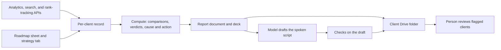

# A monthly client-reporting pipeline for a marketing agency: figures computed in code, narration written by a model, a person before anything is sent

*Benjamin Tweedy, November 2026*

## Summary

A marketing agency sends each client a monthly update: a written report and a short video in which the owner walks through the numbers. I designed and built the system that now produces the report, a slide deck, and a draft of the owner's spoken script for every client on a schedule, from the analytics APIs through to a document in the client's Drive folder. It runs monthly for 20 active clients across two brands. In the most recent run it delivered 19 clients in about 22 minutes and marked 9 of them for a person to look at before anything went out.

The design rests on one rule: numbers are computed in code, and no model touches arithmetic. A language model writes only the spoken narration, from a finished report, and every number it writes is checked against that report.

## The problem

Before this, the reports were assembled by hand in the second week of every month. The agency's SEO strategist spent 20 to 30 percent of his time pulling rankings and taking screenshots of the analytics and search dashboards for each client. The owner then spent 20 to 30 hours of that week reading the screenshots, forming a judgment, and recording a video for each of 25 to 35 clients.

Two things stood out in discovery. The hand-built documents were link collections: across two of them I found one number. And that number was wrong. A client's document said organic traffic was up 50 percent, the owner said 70 percent on camera, and the analytics API returned 165 sessions against 281, which is 70.3 percent. I tested eight combinations of metric and date range and none produced 50. The document never stated which periods it compared, so nobody could have checked it.

The work to remove was the analysis, and the analysis had to be checkable.

## Design

**One record per client per period.** Every source writes into a single typed record, and nothing downstream pulls data again. Each metric carries its scope, its comparisons, a verdict, and its provenance: the source, a readable form of the query, and when it was pulled. The last section of every report lists the exact query behind each figure.

**Verdicts by threshold, in code.** A closed vocabulary (strong win, win, steady, watch, concern) is assigned from fixed bands that I calibrated against the words the owner used for the same changes in his past videos. A decline is never rendered alone: the code attaches a cause and an action from deterministic rules, or it does not render the number.

**The model narrates a finished report.** The model receives the report with its internal notes cut out, and returns structured output: a one-sentence preview, one passage per section, and an optional closing line. The greeting and the sign-off are fixed strings assembled in code. To write the guidance for his voice I analyzed 378 transcripts of the owner's own updates from the previous twelve months, about 285,000 words, and measured how often he used each opener and close and which judgment words he attached to which size of change.

**Checks on the model's output.** A refusal or a truncated response stops that client's script with a message that says what to fix. The sections returned must match the sections in the report, in order. Every number or percentage in the script must appear verbatim in the report, and any that does not is flagged for the reviewer by section. The script can fail without costing the client their report.

**Review points.** A new client stays in an onboarding state that can generate but never deliver until a person has checked its first report against the source dashboards. Onboarding probes propose settings with their evidence and a person confirms them. Any report with something unexplained gets a "needs a look" section and status. A re-run replaces the previous files unless a person has edited them, in which case the edited copy is kept. The owner still records every video himself.

**A control plane the agency runs.** The agency's team adds a client, connects its data sources, checks access, and starts runs from a small dashboard, without me. It is server-rendered with no client-side JavaScript and sits behind an identity-aware proxy. It changes configuration only by committing a client's file to the repository through a GitHub App restricted to those paths, so no screen can alter report logic, thresholds, or code. It holds no delivery credentials. Reports are generated only by the scheduled workflow, which authenticates to Google without any stored key.

## Problems the data raised

**A correct number with a meaningless comparison.** One client's conversions read up 170 percent over the prior month because conversion tracking had gone live with eleven days left in the prior month. Nothing about the figure looked broken. Each client's configuration now lists known measurement changes, and a comparison that crosses one renders as not comparable. An onboarding detector finds these windows from daily data, and it located both of that client's known changes to the day. Only a person knows what happened in the window, so the detector proposes and a person confirms.

**Totals that did not match the vendor's own screen.** Summing sessions by channel came out 71 short of the analytics interface for one client, because the API withholds some sessions from the channel breakdown. Totals are now requested as their own report.

**Two sources that disagree and are both right.** The rank tracker listed a keyword as unranked in a city while the search console reported position 1 for it. They measure different populations. Every metric carries its scope, and code that compares across incompatible scopes throws instead of rendering. Later the rank tracker dropped from 84 ranked keywords to 3 overnight for one client while search clicks did not move, and that pattern now raises a review flag instead of a headline.

**Small bases.** A base under 30 gets a count and no percentage. Very large swings on small numbers are not cited as rates, after one client came out "up 972 percent."

**A metered API.** The rank-tracking API charges units per request. The client reads the actual cost from each response header, checks the run's budget before each call, and stays on the endpoints that are free. A full monthly run has consumed zero units.

**Access no code can grant.** Analytics and search console permissions are granted by people, and for search console only by the property owner. The dashboard's access check reports what is granted and what is missing for each source, with what a person has to do to fix it.

## Trade-offs

**Rules for cause and action, not the model.** A model would word causes more naturally and would sometimes be wrong in ways that read well. Rules are stiff and always traceable. The cost showed up in review: reading 19 reports against the owner's own recordings, the fixed bands were colder than he is, calling a 3 to 9 percent rise "steady" where he would call it growth.

**Configuration as files in the repository, no database.** Every change is an attributed commit, and every real client file is parsed by the test suite before a run touches any data. The dashboard pays for that with a commit per save and a short read cache.

**The hosted CI scheduler.** It meant no servers to run and keyless authentication. One month the scheduled run was never picked up by a runner and I ran it by hand eight days later, and the most recent one started more than seven hours after its scheduled time. For a monthly report that is acceptable. It would not be for anything a customer waits on.

**Flag a suspect number, do not block on it.** The report is the product and it is computed, so it always goes out. A script with a flagged number goes to the reviewer with the flag. That relies on the reviewer reading it.

## How it was built

I wrote the contracts first: the record schema, the configuration schema, and the interfaces between the engine, the authentication layer, and the dashboard, frozen while those parts were built. AI coding agents implemented against those contracts in separate branches, each pull request got an independent adversarial review, often two, and I read and merged every one. The reviews caught things I would not want to find in production: a token revocation ordered so that reconnecting the same account would have destroyed its new token, secrets appearing in error messages, an expression-injection path through a workflow input, and a route that let an operator bypass an administrator-only setting. Tests use no network. Fakes sit at the API boundaries, and the regression fixtures come from real client data that exposed the problems above.

## Outcome

- First commit July 31, 2026. A first review package went to the owner five days later, 19 clients were onboarded in early September, the dashboard was deployed in October, and scripts were added in November.
- The scheduled run on November 5 covered 21 configured clients: 19 delivered a report, a deck, and a script, 10 of them ready and 9 marked for review, and 2 were skipped by rule (one quarterly, one still onboarding). One client's deck failed to render and its report was delivered anyway.
- The owner and the strategist reviewed the report content and approved it. The owner's words on the call: "the bullets look good."
- The assembly that had taken 20 to 30 percent of the strategist's month is now that 22-minute run plus a read of the flagged clients.

What I would do differently. The limit on this project was the owner's time to review, not my time to build. I built the dashboard, the deck, and the script while the first reports were still waiting for feedback. I would now ship the narrowest report, get it into the monthly routine, and let the next piece wait for that. The correction loop is the clearest case: the code that turns a reviewer's edits into examples for the next draft is built and tested, and it has not yet run in production. It is still a manual step, and the scheduled run does not yet save the draft it compares against.

*Built with TypeScript and Node.js, the Google Analytics, Search Console, Sheets, and Drive APIs, the Ahrefs API, the Claude API, GitHub Actions, and Google Cloud Run. The agency and its clients are not named.*
