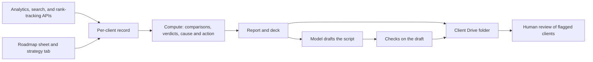

# A monthly client-reporting pipeline for a marketing agency

*Figures computed in code, narration drafted by a model, human review before anything is sent.*

*Benjamin Tweedy, November 2026*

## Summary

A marketing agency sends each client a monthly report and a short video in which the owner walks through the numbers. I designed and built the system that produces the report, a slide deck, and a draft of the owner's script for every client, from the analytics APIs to the client's Drive folder. It runs on a schedule for 20 active clients across two brands. The most recent run delivered 19 clients in 22 minutes and flagged 9 for human review.

One rule governs the design: numbers are computed in code. A language model writes only the spoken narration, from a finished report, and every number it writes is checked against that report.

## The problem

Reports were assembled by hand in the second week of each month. The agency's SEO strategist spent 20 to 30 percent of his time pulling rankings and taking screenshots of analytics dashboards. The owner then spent 20 to 30 hours reading the screenshots and recording a video for each of 25 to 35 clients.

The hand-built documents were collections of links. Across two of them I found one number, and it was wrong: the document said organic traffic was up 50 percent, the owner said 70 on camera, and the analytics API returned 165 sessions against 281, or 70.3 percent. No combination of metric and date range I tested produced 50, and the document did not say which periods it compared.

## Design

**One record per client per period.** Every source writes into one typed record, and nothing downstream pulls data again. Each metric carries its scope, comparisons, verdict, and provenance (source, query, pull time). Every report ends with the query behind each figure.

**Verdicts by threshold.** A closed vocabulary (strong win, win, steady, watch, concern) is assigned from fixed bands, calibrated against the words the owner used for the same changes in past videos. A decline never renders without a cause and an action, both produced by deterministic rules.

**The model narrates a finished report.** It receives the report with internal notes removed and returns structured output: a preview sentence, one passage per section, and an optional closing line. The greeting and sign-off are fixed strings. The voice guidance comes from 378 transcripts of the owner's past updates, about 285,000 words, measured for the openers, closes, and judgment words he uses and when.

**Checks on the output.** A refusal or truncated response fails that client's script with an actionable error. Returned sections must match the report's sections in order. Every number in the script must appear verbatim in the report, and any that does not is flagged by section. A script failure never blocks the report.

**Human review.** A new client can generate but cannot deliver until its first report has been checked against the source dashboards. Onboarding probes propose settings with their evidence for confirmation. A report with anything unexplained is marked "needs a look." A re-run replaces earlier files unless someone has edited them. The owner still records every video.

**Agency dashboard.** The agency's team adds clients, connects data sources, checks access, and starts runs. It is server-rendered with no client-side JavaScript, behind an identity-aware proxy. Configuration changes are commits made through a GitHub App restricted to the client and brand files, so the dashboard cannot alter report logic or thresholds. It holds no delivery credentials. Reports are generated only by the scheduled workflow, which authenticates to Google with no stored key.

## Problems the data raised

**A correct number with a meaningless comparison.** One client's conversions were up 170 percent because tracking had gone live with eleven days left in the prior month. Each client's configuration now lists known measurement changes, and a comparison that crosses one renders as not comparable. An onboarding detector proposes these windows from daily data, and it found both of that client's to the day.

**Totals that did not match the vendor's interface.** Summing sessions by channel ran 71 short for one client, because the API withholds some sessions from the channel breakdown. Totals are requested as their own report.

**Two sources that disagree and are both right.** The rank tracker listed a keyword as unranked in a city where the search console reported position 1. They measure different populations, so every metric carries a scope, and comparing across incompatible scopes throws. When the rank tracker later fell from 84 ranked keywords to 3 overnight for one client while search clicks held, that pattern became a review flag.

**Small bases.** A base under 30 gets a count and no percentage. Very large swings on small numbers are not cited as rates, after one client came out "up 972 percent."

**A metered API.** The rank-tracking API charges units per request. The client reads the actual cost from each response header, checks the run budget before each call, and uses the free endpoints. A full monthly run consumes zero units.

**Access that cannot be automated.** Analytics and search console permissions are granted by hand, and search console only by the property owner. The dashboard's access check lists what is missing for each source and how to fix it.

## Trade-offs

**Rules for cause and action instead of the model.** A model would word causes more naturally and would sometimes be wrong convincingly. Rules are stiff and traceable. The cost: across 19 reports compared with the owner's recordings, the bands ran colder than he does, calling a 3 to 9 percent rise "steady" where he calls it growth.

**Configuration as files in the repository.** Every change is an attributed commit, and the test suite parses every client file before a run touches data. The cost is a commit per save and a short read cache in the dashboard.

**A hosted CI scheduler.** It needs no servers and no stored credentials. One month the scheduled run was never picked up and I ran it manually eight days later, and the latest started seven hours late. That is acceptable for a monthly report and would not be for anything a customer waits on.

**Flag a suspect number instead of blocking.** The report is computed and always goes out. A script with a flagged number goes to the reviewer with the flag, which depends on the reviewer reading it.

## How it was built

I wrote the contracts first: the record schema, the configuration schema, and the interfaces between the engine, the authentication layer, and the dashboard. AI coding agents implemented against them in separate branches, each pull request got an independent adversarial review, and I reviewed and merged every one. The reviews caught a token revocation ordered so that reconnecting an account would destroy its new token, secrets in error messages, an expression-injection path through a workflow input, and a route that let an operator bypass an administrator-only setting. Tests use no network. Fakes sit at the API boundaries, and regression fixtures come from the client data that exposed the problems above.

## Outcome

- First commit July 31, 2026. First review package five days later, 19 clients onboarded in early September, dashboard deployed in October, scripts added in November.
- The November 5 scheduled run covered 21 configured clients: 19 delivered a report, deck, and script (10 ready, 9 flagged for review) and 2 were skipped by rule. One deck failed to render and its report was delivered anyway.
- The owner and the strategist reviewed and approved the report content.
- The strategist had spent 20 to 30 percent of his month assembling these reports. He now sends the owner the generated reports, which I estimate removes at least 80 percent of that preparation.

What I would do differently: the owner's review time was the constraint on this project, and I kept building past it. The dashboard, deck, and script were built while the first reports still waited for feedback. I would ship the narrowest report, get it into the monthly routine, and build the next piece after that. The correction loop is the clearest case. The code that turns a reviewer's edits into examples for the next draft is built and tested, and it has not yet run in production.

*Built with TypeScript and Node.js, the Google Analytics, Search Console, Sheets, and Drive APIs, the Ahrefs API, the Claude API, GitHub Actions, and Google Cloud Run. The agency and its clients are not named.*
