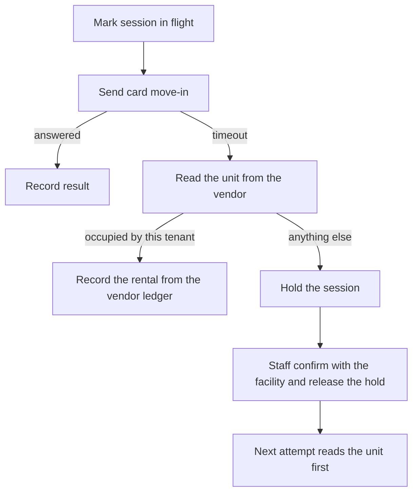

# Migrating a live self-storage checkout between two vendor systems, one location at a time

*Benjamin Tweedy, November 2026*

## Summary

I built and maintain the online rental checkout for a 25-location self-storage operator. It handles reservation, card payment, and lease signing against the operator's facility management system, the system of record for units, pricing, tenants, and ledgers. In 2026 the operator moved to a different vendor for that system, converting one facility at a time over several months.

As the sole engineer, I designed and built the second vendor integration so the checkout runs against both systems concurrently, with the backing system selected per location. It shipped on October 31, 2026. The first two facilities cut over on November 2, and the remaining locations convert on the operator's schedule with no code changes.

## Constraints

Most of these came from reading the new API and probing its sandbox.

- **Two systems of record for months.** Cutover dates belong to the operator's operations lead and the vendor's conversion team. The website has to follow a facility the morning it converts and cannot ask for a freeze.
- **The payment call cannot be retried.** The new vendor's move-in endpoint takes the card and creates the tenancy in one request, and it accepts no idempotency key. The vendor confirmed that a refused move-in fails whole and leaves no charge. If the request times out, the charge may or may not exist.
- **No signal when a lease is signed.** The incumbent system redirects the customer back with the result. The new one has no return URL and no webhook.
- **Different shapes.** One API is SOAP with integer IDs and the other is REST with OAuth 1.0 signed requests and UUIDs. The existing code cast unit IDs to integers in several places, and a UUID that begins with digits casts to an integer that can match another row.
- **A sandbox that is not the client's data.** It held the vendor's generic seed, and its test facility's card processor refused every charge until late in the build. Unit types, amenity names, and rate fields for this operator were unknown until the first real conversion.
- **Card data in scope for PCI DSS.** The new outbound service and stored credential had to be designed and documented for it.

## Design

**Adapter interface.** The five rental steps (price, reserve, protection plans, pay and move in, lease link) go through one interface with an implementation per vendor. A factory picks the implementation from the location's row and fails closed on a row that is misconfigured. The incumbent's vendor calls moved behind the interface unchanged. The page is vendor-agnostic: each implementation returns its confirmation fields and plan list in a common shape.

**Unit sync through a translator.** The scheduled and on-demand sync already grouped, classified, and stored units from the incumbent's response. I added a unit source per vendor and a translator that emits the incumbent's field names, so the sync changed in one call. A response missing required fields fails that location's sync, and the other locations keep syncing.

**The switch.** Each location row names its system. A corporate user changes it on a portal screen. The save is a conditional write, refused while the location has online rentals on or in progress. It triggers an immediate unit sync from the new system, and rentals stay off until a sync succeeds. It works in both directions, and every change writes an activity log row.

**Quote check before charge.** Before the card goes out, the move-in is quoted again. A quote whose lines do not add up to its total, or a total that differs from the accepted one by half a cent or more, refuses the payment and asks the customer to refresh. I added the same check to the incumbent path.

**Payment without an idempotency key.** The session row is marked in flight with a conditional update before the request is sent, which is also the lock against a double submit. If the call times out, the code does not send it again. It reads the unit from the vendor:

A release charges nothing, and it applies only if the row is unchanged since the staff page loaded.

**Lease signing by poll.** Every ten minutes a scheduled job reads the ledger of each paid rental from the last 21 days, least recently checked first, one run at a time. A signed lease completes the rental through the same code path as the incumbent's redirect, and completion is idempotent. The signing screen also has a button that checks that one rental immediately.

**Server-side state checks.** Turning rentals off at a location used to change only the button. A stale tab or a direct POST could still create a tenant in the wrong system, so every handler now checks the location's state on the server, refuses before any card data is read, and logs the refusal.

## Failure cases

| Failure | Handling |
|---|---|
| The vendor times out during the card move-in | Reads the unit. Records the rental if the tenant is on it, otherwise holds the session for staff |
| The customer double-clicks Pay, or pays from two tabs | The conditional update lets one request through. The other stops |
| The price changes between the quote and the payment | Payment is refused before the card is sent |
| The customer signs the lease and closes the tab | The poll completes the rental within ten minutes |
| The switch is saved while a rental is in progress | Refused. A save that races another write is refused too |
| The new system answers a sync with units missing required fields | That location's sync fails and its stored units stay as they were. Other locations are unaffected |
| A location has just been switched and no sync has succeeded | Online rentals cannot be turned on there |
| A unit has no price group in the new system | Left out of the storefront and logged, because the vendor cannot quote it |
| A stale page posts to a location whose rentals are off | Refused on the server and logged |

## Trade-offs

**Adapter vs. rewrite.** Rebuilding the checkout around the new vendor would have produced cleaner code and one implementation, and it would have put the 23 locations that were not moving yet on a new rental path. I kept the incumbent's vendor calls as they were, added the guards above to the handlers both systems share, and accepted two implementations until the last facility converts.

**The incumbent's data shape as the common model.** The translator emits the old vendor's field names rather than a neutral model. That kept the sync, grouping, and storefront out of the change, and it means the old vendor's vocabulary outlives the old vendor in this codebase. I would not make that choice in a system meant to last past the migration.

**Polling vs. postMessage.** The signing page can call `postMessage` on the parent window when the customer finishes. That is immediate and free, and it never arrives if the customer closes the tab or signs on another device. The poll costs one ledger read per open rental per cycle.

**Hold vs. retry.** A retry is harmless when the first request never arrived and charges the card twice when it did, and from the outside the two look the same. Reading the unit settles the case where the vendor finished the move-in. Every other case waits for a staff member, which is slower for that customer and never double-charges.

## How it was built

I wrote the specification for each phase and the rules it had to enforce, used AI coding tools to implement and test against it, and reviewed each phase as its own pull request. The rules in the design section each have a test. Only the vendor boundary is faked: integration tests run the sync and the handlers against a real database, and the request-signing tests are pinned to signatures verified against the live sandbox.

The day before release I ran an adversarial AI review of the whole codebase and checked each finding against the code and the production schema before acting on it. Two of its claims were wrong and I rejected them. The real findings were fixed before release: a held payment that could never be paid after its release, because the unit stays reserved and the release path accepted only vacant units; step writes that were not conditional; a check-then-write race in the switch; and anonymous quote endpoints with no nonce or rate limit.

## Outcome

- Released to production on October 31, 2026 with every location still on the incumbent system. The build ran about four weeks from the first commit.
- On the morning of November 2 the vendor converted the two pilot facilities. After test rentals through the production checkout, online rentals were back on at both that afternoon.
- The day after cutover, a facility manager reported units showing online that had been hidden in the old system. I confirmed the same afternoon that the site was showing exactly the units the new system marked rentable. The old system's hide-from-web setting had not carried over in the conversion, and the vendor corrected the units on its side.
- The remaining locations are converting on the operator's schedule, each by the same portal switch.

What I would do differently: insist on one facility's converted data in the sandbox before release. The unit-type and amenity mapping was written against seed data, and the first look at real converted data was production.

Stack: PHP, MariaDB, Vue.js, SOAP and REST (OAuth 1.0) vendor APIs.
